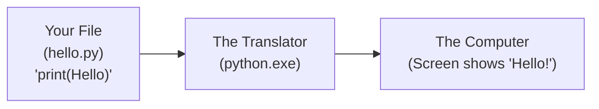
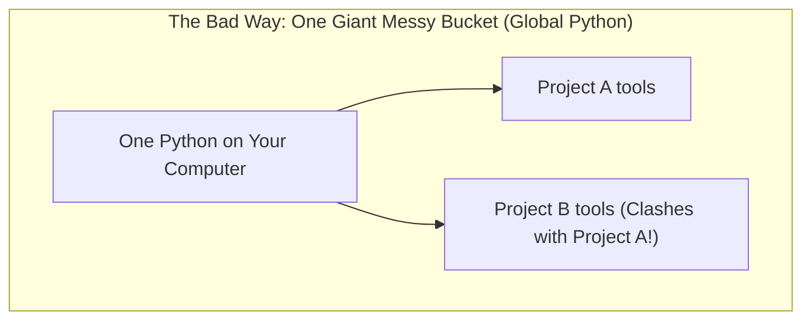
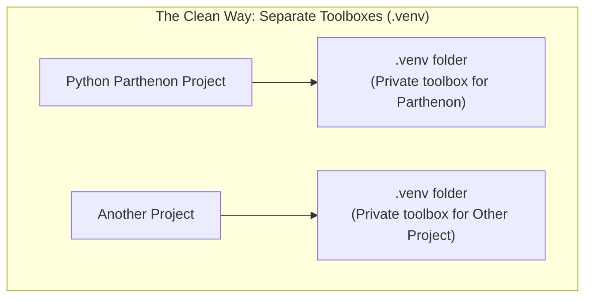

# How Python Actually Works: From Hello World to Environments

If you only know how to type `print("Hello, World!")`, welcome! 

This guide is written specifically for you. No confusing jargon, no assumptions. We are going to build your mental model from scratch.

---

## 1. What is Python, Really?

Think of your computer as a super-fast worker who only understands raw electrical signals (1s and 0s). It does **not** understand English or human thought.

Python is a **translator** (programmers call it an **interpreter**):
1. You write instructions in plain English-like text in a file ending with `.py` (for example, `print("Hello!")`).
2. You hand that text file to the Python program (`python.exe`).
3. Python reads your file line by line, translates each line into computer actions, and executes them instantly.



---

## 2. What is the Terminal (PowerShell) and How Does It Find Python?

When you open **PowerShell** or Command Prompt, you are looking at a text conversation with your operating system (Windows).

When you type:
```powershell
python hello.py
```
Windows does something very simple:
1. Windows looks at the first word: `python`.
2. Windows asks itself: *"Do I have a program called `python.exe`?"*
3. To find it, Windows looks through a list of folders saved in its memory. This list of folders is called the **PATH** (think of it as Windows' personal address book).
4. As soon as Windows finds `python.exe` in one of those folders, it wakes it up and hands it your `hello.py` file.

### Where Did "Scoop" Come From?
You installed Python using a tool called **Scoop**. 
- Normally, when you install software on Windows, installers scatter files into 5 different hidden system folders and the Windows Registry.
- **Scoop is just a neat organizer.** It downloads Python into one clean folder (`C:\Scoop\apps\python\`) and puts a small shortcut (called a *shim*) into Windows' address book so Windows can find it whenever you type `python`.

---

## 3. What is a "Package" and What is `pip`?

Python comes with lots of built-in superpowers (like math tools, file tools, and date tools). This is called the **Standard Library**.

However, millions of programmers around the world write extra tools for Python (for games, data analysis, websites, AI). These extra toolsets are called **packages** or **libraries**.

- **`pip`** is like the **App Store** for Python.
- If you want a tool someone else made, you usually type: `pip install toolname`.
- `pip` downloads that tool from the internet and saves it on your computer so your Python scripts can use it with `import toolname`.

---

## 4. Why Do We Need "Environments"? (The Toolbox Analogy)

Imagine you are working on two different DIY projects at home:
- **Project A** (Building a wooden chair): Needs a small 10mm screw.
- **Project B** (Fixing a garden fence): Needs a large 50mm screw.

If you throw all your tools and screws into **one giant bucket in your garage**:
- Eventually, screws get mixed up.
- One project needs an older version of a tool, but the other project upgraded it and broke everything.
- This mess is what programmers call **"Dependency Hell."**



### The Solution: A "Virtual Environment"
A **Virtual Environment** (often just called a `.venv`) is **NOT** a virtual machine or a whole computer simulation. 

It is literally just **a separate folder on your disk**:
- It gives your project its own private mini-toolbox.
- When you are working in `Python Parthenon`, you create a `.venv` folder right here.
- Any packages you download go **only into this folder**.
- If you ever want to reset or delete the project's tools, you simply delete that `.venv` folder. Your main computer remains completely untouched and clean.



---

## 5. How Does Git & GitHub Connect to All This?

Think of **Git** as an infinite "Save Game" button, and **GitHub** as your online backup and portfolio.

Here is the most important rule every beginner must learn:

> **Git tracks your RECIPES (your code), NOT the heavy ingredients or kitchen equipment.**

When you bake a cake:
- You share the **recipe card** with your friend: *"Mix 2 cups of flour and 1 egg."*
- You do **not** put a 50kg bag of flour and an oven into an envelope and mail it to them!

In software:
- **Your Code (`.py`, `.md`)** = The Recipe. This goes into Git and GitHub.
- **Your Environment (`.venv`)** = The Kitchen Equipment and heavy ingredients. This stays on your computer.

Our file [.gitignore](file:///e:/Academy/Python%20Parthenon/.gitignore) is a list telling Git:
*"Hey Git, ignore the `.venv` folder! Do not upload thousands of downloaded files to GitHub. Only upload the code I actually wrote."*

---

## 6. Summary of Key Words to Remember

| Term | In Plain English |
| :--- | :--- |
| **Script (`.py`)** | A text file containing instructions you wrote for Python. |
| **Interpreter (`python.exe`)** | The program that reads your `.py` text file and executes it. |
| **Terminal / PowerShell** | The black or blue text window where you type commands to your computer. |
| **PATH** | Windows' address book of folders where it looks for programs. |
| **Package / Library** | Code someone else wrote that you can borrow (e.g. for games, math, AI). |
| **`pip`** | The "App Store" tool that downloads packages from the internet. |
| **Virtual Environment (`.venv`)** | A private folder created inside your project to hold its specific tools without cluttering your computer. |
| **Git / GitHub** | The tool that tracks changes to your code files and backs them up online. |
