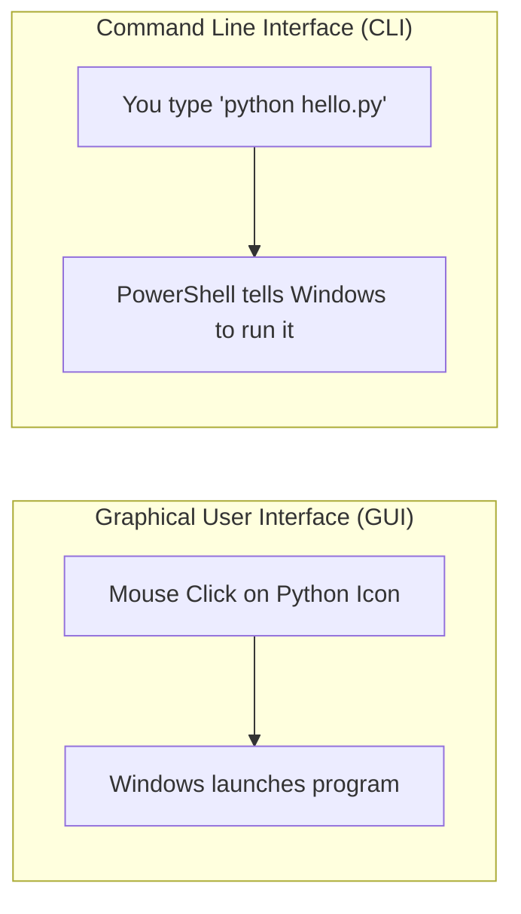
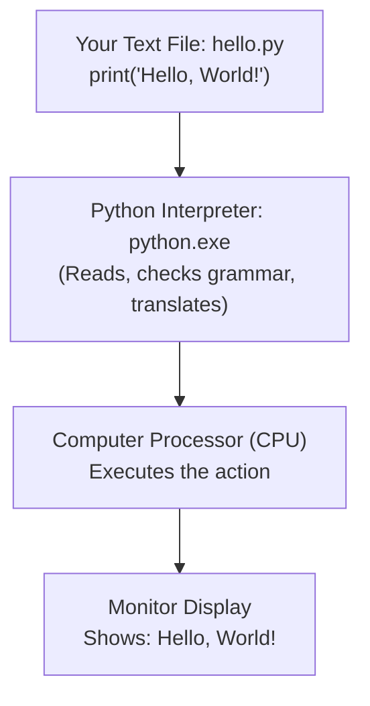
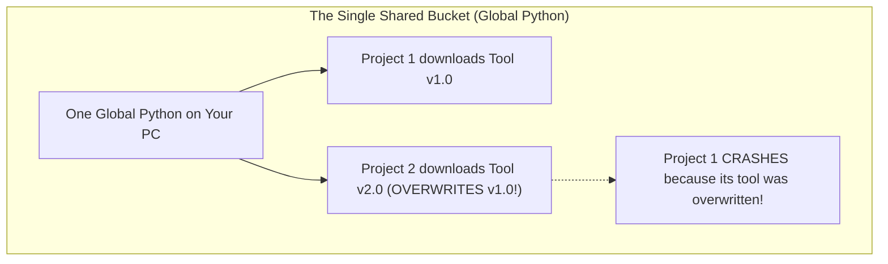
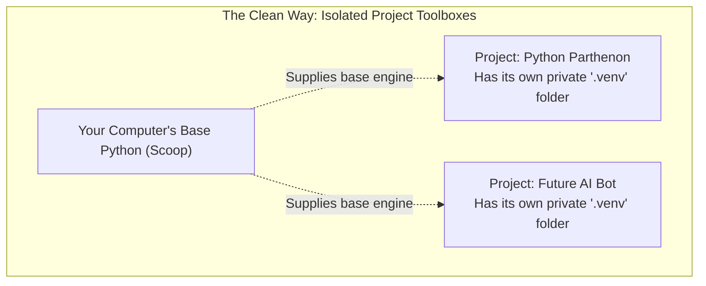

# The Absolute Beginner's Codex: How Python Runs, What Files Mean, and Why Environments Exist

If your entire programming knowledge right now is:
```python
print("Hello, World!")
```
**You are in the exact right place.** 

In this document, we assume zero prior knowledge. We will build your mental model from the bedrock up. By the time you finish reading, words like *file extension*, *terminal*, *PATH*, *interpreter*, *pip*, *virtual environment*, and *Git* will no longer be mysterious buzzwords—they will be clear, intuitive physical concepts in your mind.

---

## 1. Demystifying Files & File Extensions

Before we talk about programming languages, we must talk about files.

### What is a File?
Every single thing saved on your computer's hard drive—a movie, a photo, a document, a song—is just a collection of numbers (bytes) stored in storage sectors.

To help humans and computers organize these collections of numbers, the computer gives them a **File Name** and a **File Extension**:
```text
my_notes.txt
  │       │
  │       └── File Extension (Tells the computer WHAT KIND of file this is)
  └────────── Base Name (What you chose to name it)
```

### What Does the Extension Tell the Computer?
The extension is the suffix that comes after the dot (`.`). It tells the Operating System (Windows):
1. **How the data inside is formatted.**
2. **Which program should open it.**

If you double-click a file ending in `.mp3`, Windows knows to launch a music player. If you double-click `.docx`, it launches Microsoft Word.

### The 5 File Extensions You Will See in This Repository

| Extension | Full Name | Is it Human-Readable Text? | What is Its Purpose? |
| :--- | :--- | :--- | :--- |
| **`.py`** | **Python Script** | **YES** | A plain text file containing instructions written in Python. You can open and edit it in Notepad, VS Code, or any text editor. When you pass it to Python, Python executes those instructions. |
| **`.md`** | **Markdown Document** | **YES** | A plain text file formatted with simple human-friendly symbols (like `#` for big headings, `**bold**`, and `-` for bullet points). Modern code editors and GitHub automatically render these into styled articles with colors, diagrams, and clickable links. |
| **`.exe`** | **Executable Binary** | **NO** (Raw machine code) | A compiled program made of raw processor instructions. Humans cannot read it with a text editor. Examples: `python.exe`, `chrome.exe`, `notepad.exe`. When you run an `.exe`, your computer's processor (CPU) runs the instructions directly. |
| **`.cfg`** | **Configuration File** | **YES** | A short, simple text file that stores settings for a program, usually formatted as `name = value`. Python uses a file called `pyvenv.cfg` to remember where your virtual environment lives. |
| **`.gitignore`** | **Git Ignore List** | **YES** | A special text file (with no base name, just `.gitignore`) that tells Git: *"Never upload these folders or files to GitHub!"* |

---

## 2. What is the Operating System, the Terminal, and a "Command"?

### GUI vs. CLI: Two Ways to Talk to Your Computer
- **GUI (Graphical User Interface):** The way most people use computers. You look at desktop icons, open folders with a mouse, and click buttons.
- **CLI (Command Line Interface / The Terminal):** The way software engineers talk to computers. Instead of clicking buttons, you type sentences called **commands** into a text window (like **PowerShell** on Windows), and the computer executes them and types back an answer.



### What is a "File Path"?
Every file has an exact home address on your hard drive. This address is called a **Path**:
- **Absolute Path:** The full, complete address from the drive root:
  `E:\Academy\Python Parthenon\README.md`
- **Relative Path:** The address relative to where you are standing right now. If your terminal is already inside `Python Parthenon`, the relative path to `README.md` is simply:
  `./README.md` (or just `README.md`).

---

## 3. What Happens When You Type `python`? (The PATH Address Book)

When you open PowerShell and type:
```powershell
python
```
How does Windows know what you mean? Windows is not a psychic mind-reader. It doesn't instantly know where every program is stored on an 8-terabyte hard drive.

### The Secret: The `PATH` Environment Variable
Windows maintains a private "Address Book" inside its memory called the **`PATH`**. 
The `PATH` is a list of specific folders on your computer:

```text
Folder 1: C:\Windows\System32
Folder 2: C:\Scoop\shims
Folder 3: C:\Users\Navam\AppData\Local\Programs\...
```

When you type `python`:
1. Windows looks in **Folder 1**. Is there a `python.exe` there? No.
2. Windows moves to **Folder 2** (`C:\Scoop\shims`). Is there a `python.exe` there? **YES!**
3. Windows stops searching and runs that file!

If a program is **not** in any of the folders listed in Windows' `PATH`, Windows gives you that famous error:
> `'python' is not recognized as an internal or external command, operable program or batch file.`

---

## 4. What is Python, Really? (The Language vs. The Interpreter)

There are two completely different things that people call "Python," and confusing them is why so many beginners get lost:

### A. Python the Language (The Grammar Rules)
Python is a set of human-readable grammar rules invented by Guido van Rossum in 1991:
- To show text, use `print(...)`.
- To make a choice, use `if ... else ...`.
- Indent your code with 4 spaces to group thoughts together.

This language is just an agreed-upon human syntax. A text file containing Python code (`hello.py`) is just inert text sitting on your hard drive. By itself, it cannot do anything.

### B. Python the Interpreter (`python.exe` — The Engine)
The **Interpreter** is a real computer program compiled into machine code (`python.exe`). 

It acts as a live translator:
1. It opens your `.py` text file.
2. It reads the first line.
3. It checks your grammar (syntax). If you made a typo, it stops and complains (`SyntaxError`).
4. If the grammar is correct, it translates that line into instructions your computer's CPU understands, runs it immediately, and then moves to the next line.



---

## 5. What is Scoop and What is a "Shim"?

You installed Python using a program called **Scoop**. Why?

### The Traditional Windows Installer (The Messy Way)
Normally, when you download an installer (`python-installer.exe`) from the web:
- It asks you 6 wizard questions.
- It scatters files into `AppData`, `Program Files`, and deep hidden system directories.
- It writes dozens of entries into the Windows Registry.
- If you ever want to uninstall it or manage versions, leftover files remain scattered all over your computer.

### The Scoop Way (The Tidy Drawer)
Scoop is a modern package manager for Windows that treats software like tidy items in labeled drawers:
- Everything it installs goes into one single folder: `C:\Scoop\apps\`.
- Your Python lives cleanly in `C:\Scoop\apps\python\current\`.

### What is a "Shim"?
Because Scoop keeps Python tucked away in its own tidy folder, how does Windows know where to find it?
Scoop creates a tiny 15-kilobyte forwarder program called a **Shim** at:
`C:\Scoop\shims\python.exe`

When you type `python` in your terminal:
1. Windows runs the tiny **Shim** in `C:\Scoop\shims\python.exe`.
2. The shim acts like an automatic receptionist: it immediately passes your command to the real Python at `C:\Scoop\apps\python\current\python.exe`.
3. Your computer stays 100% clean, and Windows never has to edit its registry!

---

## 6. What are Packages and What is `pip`?

When you install Python, it comes with a backpack full of built-in tools called the **Standard Library**:
- Tools for doing math (`import math`).
- Tools for working with dates (`import datetime`).
- Tools for asking questions about your computer (`import sys`).

These are built right into Python—you never have to download them.

### What is a Third-Party Package?
Imagine you want to build a machine learning model, a high-frequency trading bot, or a quantum simulation. Writing all that math from scratch would take 10 years!

Luckily, brilliant engineers around the world write extra toolsets and share them for free. These toolsets are called **packages** or **libraries**.

### What is `pip`?
**`pip`** is the **App Store installer** for Python.
- When you type `pip install package_name`, `pip` reaches out over the internet to a giant public repository called **PyPI** (Python Package Index).
- It downloads the package files.
- It unpacks them onto your computer so your Python scripts can write `import package_name` and use them!

---

## 7. The Big Problem: Why Do We Need "Environments"? (The Toolbox Dilemma)

Now we arrive at the question you asked: **Why does everyone talk about "environments"?**

Let's use a real-world story.

### The Messy Single Toolbox
Imagine you are an engineer working on two different inventions in your workshop:
- **Invention 1 (A Clock):** Requires a delicate, tiny 2mm gear (Version 1.0 of the gear).
- **Invention 2 (A Bicycle):** Requires a heavy-duty 10mm gear (Version 2.0 of the gear).

Now imagine you only own **one shared toolbox** in your entire house:
1. You start working on the Clock. You buy Gear Version 1.0 and throw it into the toolbox. The clock works!
2. Six months later, you start building the Bicycle. You need Gear Version 2.0. You download it, and it **overwrites** Gear Version 1.0 in your toolbox.
3. You go back to your Clock to fix something. You turn it on. **CRASH!** The clock is completely destroyed because its delicate gear was replaced by the bicycle gear!

In programming, this nightmare is called **Dependency Hell**. If you install all your packages into one single global Python on your computer, sooner or later, two projects will fight over different versions of the same tool, and both will break.



---

### The Clean Solution: A "Virtual Environment" (`.venv`)

A **Virtual Environment** sounds like something out of science fiction, but it is actually the simplest thing in the world:

> **A Virtual Environment is literally just a private folder named `.venv` created inside your project.**

When you create a virtual environment inside your `Python Parthenon` folder:
1. Python creates a small folder called `.venv/`.
2. Inside `.venv/`, it puts a private copy of the `pip` installer and a private `site-packages/` folder (where downloaded tools live).
3. Inside `.venv/`, it puts a tiny 4-line text file called `pyvenv.cfg` that says:
   ```ini
   home = C:\Scoop\apps\python\current
   include-system-site-packages = false
   ```
4. Now, whenever you install a tool using `pip`, it downloads **only into your local `.venv` folder**.
5. Your main computer Python remains pristine and untouched.
6. Other projects on your computer have their own separate `.venv` folders, so nothing can ever clash or break!



---

## 8. How Does Git & GitHub Connect to All This?

Now, how does Git fit into this picture?

### The Golden Rule: The Recipe vs. The Heavy Kitchen Equipment

Imagine you invented a delicious chocolate cake recipe, and you want to mail it to your friend across the country so they can bake it too.

What do you put in the envelope?
- **Option A:** You mail them a handwritten recipe card that says:
  *"Ingredients: 2 cups flour, 1 cup cocoa, 2 eggs. Bake at 350°F for 30 minutes."*
- **Option B:** You hire a freight truck to mail them your entire 200-pound kitchen oven, a 50-pound sack of flour, and your dirty mixing bowls.

Obviously, you choose **Option A**! The recipe card is light, fits in a small envelope, and your friend can use their own oven to bake the cake.

### In Software Development:
- **Your Code (`.py`, `.md`)** = The **Recipe Card**.
  - It is tiny (a few kilobytes of text).
  - It is what you write.
  - **This is what we send to Git and GitHub!**
- **Your Virtual Environment (`.venv`)** = The **Heavy Kitchen Oven & Bags of Flour**.
  - It contains thousands of downloaded files and compiled binary files specific to your exact Windows machine.
  - It can weigh 500 Megabytes to 2 Gigabytes!
  - If you tried to send `.venv` to someone on a Mac or Linux computer, it wouldn't even work because Windows `.exe` files don't run on Mac!
  - **This NEVER goes into Git or GitHub.**

### The Role of `.gitignore`
Our repository contains a file named [.gitignore](file:///e:/Academy/Python%20Parthenon/.gitignore).
Inside that file, there is a simple line:
```text
.venv/
```
That line tells Git:
> *"Whenever I make a commit or push to GitHub, act as if the `.venv/` folder is invisible. Never upload it!"*

Whenever someone downloads your project from GitHub, they download your lightweight code files, and with one simple command, their computer automatically recreates a fresh `.venv` on their machine in 5 seconds.

---

## 9. Plain-English Glossary of the 8 Essential Terms

| Term | What It Means in Real Life |
| :--- | :--- |
| **1. Source File (`.py`)** | A plain text file with instructions written in Python grammar. |
| **2. Markdown File (`.md`)** | A plain text file formatted with headings and lists that renders like a clean article. |
| **3. Interpreter (`python.exe`)** | The engine program that reads your `.py` text and runs it on your computer. |
| **4. Terminal / PowerShell** | The text window where you type direct text commands to your operating system. |
| **5. PATH** | Windows' address book of folders where it looks for programs. |
| **6. Package / Library** | Code someone else wrote that you can borrow so you don't have to reinvent the wheel. |
| **7. `pip`** | The App Store installer tool that downloads packages from the internet. |
| **8. Virtual Environment (`.venv`)** | A private folder inside your project that keeps its tools separate from the rest of your computer. |

---

## 10. Self-Reflection & Next Step

Take a moment to let these ideas settle. You now understand:
1. What files and file extensions are.
2. How Windows finds Python via `PATH`.
3. The difference between Python the language and `python.exe` the program.
4. Why Scoop puts things where it does.
5. Why we never install packages globally and instead use `.venv`.
6. Why Git only stores our recipes, not the heavy `.venv`.

Now, open **[2026-10-11_execs_runtime_probe.py](./2026-10-11_execs_runtime_probe.py)** to see these exact concepts running live on your computer screen!
