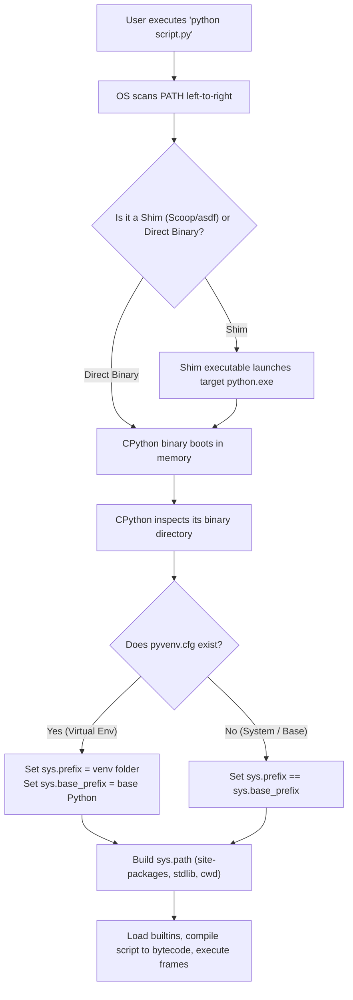
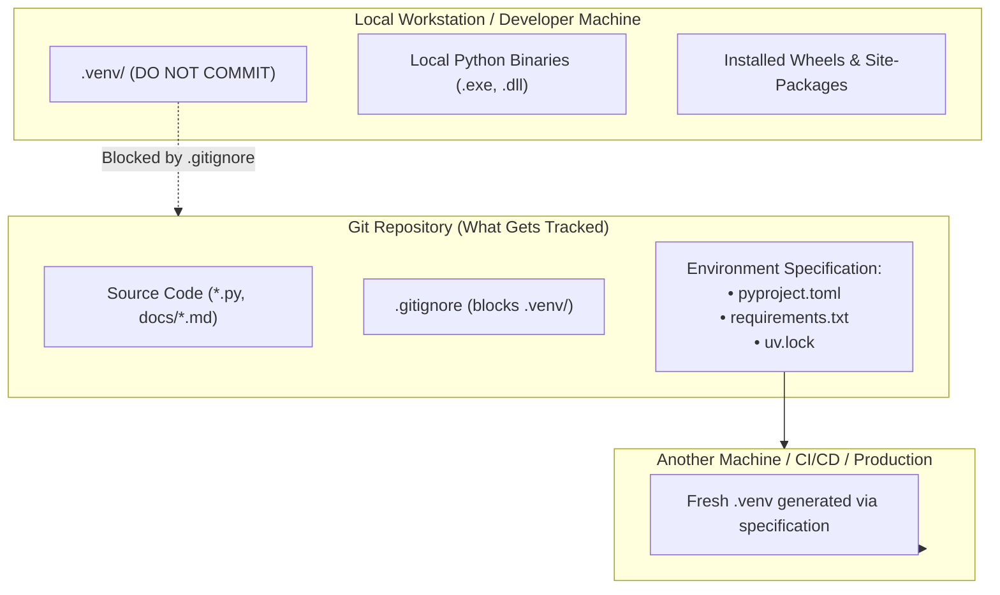

# CPython Execution Mechanics & Environment Architecture

Understanding how Python runs on an operating system, how environments isolate state, how they interface with Git, and which tools to use across different engineering domains.

---

## 1. Anatomy of the Boot Sequence: What Happens When You Type `python`?

When you execute a command in PowerShell or Bash:
```powershell
python script.py
```
A deterministic series of steps occurs across the OS and the CPython runtime:



### The Role of `PATH` and Shims
- On Windows, the OS searches directories listed in `$env:PATH` sequentially.
- **Scoop's Shim Architecture**: Scoop installs binaries into versioned folders like `C:\Scoop\apps\python\<version>\python.exe` and creates small redirector binaries ("shims") inside `C:\Scoop\shims\python.exe`.
  - When you run `python`, you run the shim.
  - The shim invokes the current version of CPython without polluting system-wide Windows Registry entries.

---

## 2. How CPython Detects Environments: The `pyvenv.cfg` Protocol (PEP 405)

A common myth is that a virtual environment is a completely separate copy of Python. In reality, modern virtual environments (specified by [PEP 405](https://peps.python.org/pep-0405/)) are **redirection pointers**.

When CPython boots:
1. It looks in the directory containing `python.exe` (and its parent directory) for a file named `pyvenv.cfg`.
2. If `pyvenv.cfg` is absent, Python runs in **base system mode**:
   - `sys.prefix` (where third-party packages are installed) equals `sys.base_prefix` (where the Python executable and standard library live).
3. If `pyvenv.cfg` is present, it looks like this:
   ```ini
   home = C:\Scoop\apps\python\current
   include-system-site-packages = false
   version = 3.14.4
   executable = C:\Scoop\apps\python\current\python.exe
   command = C:\Scoop\apps\python\current\python.exe -m venv .venv
   ```
4. CPython reads the `home` key and sets:
   - `sys.base_prefix`: points to `home` (the base interpreter with the standard library C modules).
   - `sys.prefix`: points to the local virtual environment folder.
   - `site-packages`: points to `.venv\Lib\site-packages\`.

Because `include-system-site-packages = false`, the interpreter completely ignores whatever packages are installed in the global base Python.

---

## 3. Why Global `pip install` Fails or Breaks (Especially on Scoop)

### The Three Failure Modes of Global Package Installations
1. **Dependency Hell (Diamond Dependency Conflict)**:
   - Project A requires `pydantic>=2.0.0`.
   - Project B requires an older package locked to `pydantic<2.0.0`.
   - In a global environment, one project will always be broken.
2. **Scoop Upgrade Erasure**:
   - When you run `scoop update python`, Scoop switches its `current` symlink to the new version directory. Any packages manually injected into the old `Lib\site-packages` are left behind.
3. **Missing Executable Shims**:
   - When tools like `pytest` or `black` are installed via `pip`, they place a wrapper `.exe` into `Scripts/`. Because Scoop does not monitor arbitrary pip installs, that `.exe` is never added to your PATH, resulting in:
     `'pytest' is not recognized as the name of a cmdlet...`

---

## 4. The Environment Landscape: Comparison & Trade-Offs

| Tool / Environment | How It Works Under the Hood | Advantages | Disadvantages | Primary Use Cases |
| :--- | :--- | :--- | :--- | :--- |
| **Built-in `venv`**<br>`python -m venv .venv` | Creates `pyvenv.cfg` pointing back to base Python. Uses standard library only. | Built-in to Python; zero external tools needed; universal compatibility. | Slow wheel installation via standard `pip`; cannot switch base Python versions. | Quick scripting, standard library development, minimal dependencies. |
| **`uv` (by Astral)**<br>`uv venv` / `uv run` | Written in Rust. Re-implements resolver and installer; creates instant venvs with symlinks and hardlinks. | **10–100x faster** than pip; manages multiple Python versions automatically; generates cross-platform lockfiles. | Third-party binary (must be installed via Scoop or standalone installer). | Modern backend engineering, AI orchestration, agent development, general Python. |
| **Conda / Mamba / Pixi** | Cross-language package manager. Ships compiled non-Python C/C++/Fortran binaries alongside Python. | Solves heavy non-Python native dependencies (CUDA, BLAS, LAPACK) without needing local C compilers. | Heavy disk footprint; slower package solver (unless using Mamba/Pixi); non-standard package repo (`conda-forge`). | Deep Learning with GPU drivers, legacy scientific computing, bioinformatics. |
| **Docker / Containers** | OS-level virtualization (Linux kernel namespaces & cgroups). | Complete environment parity across machines; encapsulates OS libraries, system packages, and Python runtime. | Overhead of container engine; slower file I/O on Windows (WSL2 boundary); heavier prototyping loop. | Microservices deployment, reproducible production runs, sandboxed agent execution. |

---

## 5. Connecting Environments to Git: The Golden Rules



### The Golden Rule of Version Control
> **Never commit virtual environments to Git. Always commit the recipe (specification) to reproduce them.**

### Why You Must Never Commit `.venv/`:
1. **Hardcoded Absolute Paths**: In Windows virtual environments, the scripts in `.venv\Scripts\` have hardcoded shebang lines:
   ```text
   #!E:\Academy\Python Parthenon\.venv\Scripts\python.exe
   ```
   If someone clones your repo to `C:\Projects\`, the environment will immediately crash.
2. **Platform Incompatibility**: Compiled C-extensions (`.pyd` or `.dll` on Windows) cannot run on Linux or macOS.
3. **Repo Bloat**: A typical machine learning or data science virtual environment can exceed 2GB and 50,000 files. Committing this will permanently ruin Git history and clone times.

### What Goes into Git Instead:
- **`pyproject.toml`** (Modern Standard): Declares the project metadata and direct dependencies.
- **`requirements.txt`**: Flat list of dependencies (used for legacy or simple workflows).
- **`uv.lock`** or **`poetry.lock`**: Exact cryptographic hashes and pinned versions of every recursive dependency, ensuring 100% deterministic builds across team members and servers.

---

## 6. Official References & Further Reading

- [PEP 405 – Python Virtual Environments](https://peps.python.org/pep-0405/)
- [CPython `sys` module documentation](https://docs.python.org/3/library/sys.html#sys.prefix)
- [CPython `site` module initialization](https://docs.python.org/3/library/site.html)
- [Astral `uv` Architecture & Documentation](https://docs.astral.sh/uv/)
- [PEP 518 & PEP 621 – Specifying Dependencies in `pyproject.toml`](https://peps.python.org/pep-0621/)
