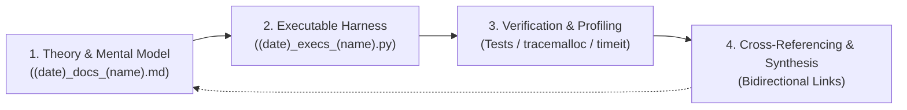

# Python Parthenon

An engineering codex and playground designed to build deep, first-principles proficiency in Python—exploring the language's mechanics, memory layout, limits, and paradigms across software engineering, algorithms, systems, and advanced computation.

---

## 🏛️ The Philosophy

Mastering Python does not mean memorizing utility functions. It means understanding:
- **Mechanical Sympathy**: How CPython manages memory, evaluates frames, dispatches calls, and interacts with the operating system.
- **The Data Model**: How dunder protocols and descriptors define the language's structural behavior.
- **Computational Ceilings**: Where interpreted Python thrives, where it bottlenecks, and how to transition to vectorization, JIT, or native extensions.
- **Prototyping Intuition**: The ability to translate an abstract mathematical model, system design, or paper into reliable, testable, benchmarked code.

---

## 📐 The Study Protocol

Every topic explored in this repository follows a four-stage execution loop:



### 1. Conceptual Deep-Dive (`(date)_docs_(name).md`)
- Explains the *why* and *how* behind the concept from first principles.
- Includes memory/architectural flowcharts (using Mermaid).
- Features code snippets dissecting edge cases and anti-patterns.
- Direct links to official CPython documentation, PEPs, and canonical source references.

### 2. Executable Challenge Harnesses (`(date)_execs_(name).py`)
- Practical problem files containing clear docstring specifications and type annotations.
- Starter template functions and class skeletons.
- Built-in test harnesses (assertion blocks or test runners) validating correctness and boundary conditions.

### 3. Verification, Profiling & Disassembly
- Beyond simply "working" code, solutions are stress-tested:
  - **Correctness**: Comprehensive assertions covering edge cases.
  - **Memory Impact**: Profiling allocations with `tracemalloc`.
  - **Execution Latency**: Benchmarking with `timeit` or `cProfile`.
  - **Bytecode Inspection**: Understanding interpreter instructions with the `dis` module.

### 4. Cross-Referencing & Interconnected Codex
- Topics and exercises are cross-linked via relative markdown links for seamless navigation and revision.
- Every practical challenge links back to its theoretical foundation, and advanced topics reference prerequisite mechanics.

---

## 📂 Repository Layout

Topic modules are created organically as we progress through concepts:

```text
Python Parthenon/
├── .gitignore             # Ignore bytecode, virtual environments, caches
├── README.md              # Master codex & study protocol
│
└── <topic_module>/        # Created as topics are explored
    ├── README.md          # Topic overview and lesson roadmap
    ├── <YYYY-MM-DD>_docs_<topic>.md      # Conceptual notes and diagrams
    └── <YYYY-MM-DD>_execs_<exercise>.py   # Executable problem harnesses and tests
```

---

## 🗺️ Active Topic Modules

| Module | Focus Area | Status |
| :--- | :--- | :--- |
| [01_runtime_and_environments](./01_runtime_and_environments/README.md) | OS PATH, Shims, CPython Boot, PEP 405 `pyvenv.cfg`, Git Boundaries, Tool Trade-Offs | In Progress |

---

## 🛠️ Environment & Runtime

- **Active Runtime**: Python 3.14+ (CPython)
- **Tooling**: Built-in standard library, automated test runners, and isolated virtual environments.

